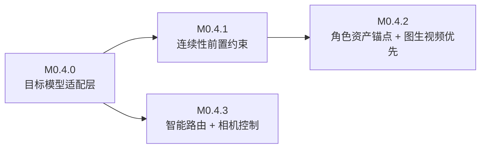
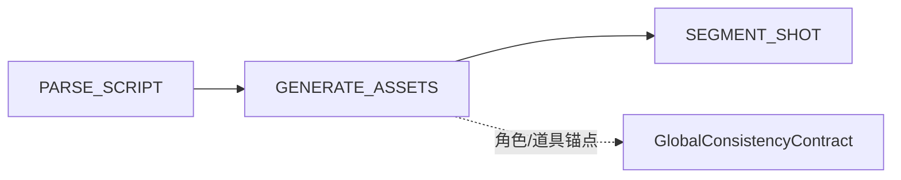

# 0.4 开发路线图与设计

> 本文是 `PenShot` 0.4 版本的正式开发路线图与功能设计文档。
> 目标读者：参与 0.4 开发的工程师、评审者。
> 依赖文档：[docs/架构演进：从 MVP 到成品.md](./architecture/架构演进：从 MVP 到成品.md)、[docs/任务计划.md](./任务计划.md)。

---

## 1. 背景与目标

0.3 已经完成了"多智能体流水线 + 任务化服务 + 工作流编排 + 状态拆分"的骨架。但 [v0.3 评测报告](./testing/v0.3%20功能完成度评测报告.md) 显示：连续性能力仍是"末端检查"而非"前置约束"，向量检索未启用，且产出的 prompt 是**通用 prompt**，没有面向目标视频模型的差异化适配。

0.4 的定位一句话概括：

> **把"能拆剧本"升级为"能稳定产出面向特定视频模型、角色与场景高度一致的分镜资产"。**

### 1.1 关键边界判断（必须先达成共识）

[docs/任务计划.md](./任务计划.md) 里的需求池，实际混了两类完全不同的工作：

| 类别 | 示例 | 归属 |
|---|---|---|
| **PenShot 本体**（文本 → 分镜 → 提示词） | 一致性契约、角色设定图、相机控制、模型路由 | 0.4 核心 |
| **下游视频生成与后期**（依赖真实视频产物） | VQA/VLM 打分、唇形同步、超分、去闪烁、文本后期合成 | 应作为独立下游层或延后 |

**结论**：PenShot 当前输出的是"提示词片段"，并没有真正生成视频。因此 0.4 应聚焦在 **① 把一致性/资产/相机控制压进 prompt 层**，**② 增加目标模型适配与智能路由**。视频级的质量评估(3C)、唇形同步、后期合成依赖真实视频产物，列入 0.5 或独立下游模块，**不在 0.4 范围**。

### 1.2 生成边界决策（已定）

2026-11-01 确认，作为 0.4 的硬约束：

| 生成能力 | 边界 | 落点 |
|---|---|---|
| **视频生成**（图生视频/文生视频，Runway/Kling/Sora） | **纯指令层**：PenShot 不调用任何视频模型 API，只产出机器可读的 `route_plan` + `prompt` + `camera` + `asset_ref`，由下游视频生成管线执行 | M0.4.3 的终点就是产出 `route_plan` |
| **文生图**（角色三视图/道具静帧，Flux/Ideogram） | **内置文生图客户端**：0.4 新增文生图客户端，直接生成真实资产并挂到契约 | M0.4.2 内置 `ImageGenerationClient` |

**由此推导的三条硬规则**：

1. 不引入视频模型 Key、不处理长耗时异步视频任务轮询与计费。
2. `route_plan` 必须是**结构化、可序列化、下游可直接消费**的完整指令包，而非人类阅读文本。
3. 文生图客户端走现有 `neopen/client/` 层模式（provider 工厂 + fallback），仅产出静态图，不做任何视频生成。

---

## 2. 现状盘点

对照代码仓库，0.4 的起点如下：

### 2.1 已完成（0.3 遗留，可直接复用）

- ✅ 状态拆分：[workflow_state_types.py](../src/penshot/neopen/agent/workflow/workflow_state_types.py) 已区分领域态/执行态/错误态/配置态/输出态
- ✅ 工作流编排：[workflow_pipeline.py](../src/penshot/neopen/agent/workflow/workflow_pipeline.py) + [workflow_decision.py](../src/penshot/neopen/agent/workflow/workflow_decision.py) 已具备条件路由/循环/人工干预/错误处理
- ✅ 连续性契约原型：[consistency_contract.py](../src/penshot/neopen/agent/continuity_guardian/consistency_contract.py) 已有 `GlobalConsistencyContract / CharacterContract / SceneContract`
- ✅ 长剧本分块 / 跨块校验 / 风格守护原型：[long_script_chunker.py](../src/penshot/neopen/agent/continuity_guardian/long_script_chunker.py)、[cross_chunk_validator.py](../src/penshot/neopen/agent/continuity_guardian/cross_chunk_validator.py)、[prompt_style_guardian.py](../src/penshot/neopen/agent/continuity_guardian/prompt_style_guardian.py)
- ✅ 三层记忆 + llamaIndex/Chroma 骨架：[knowledge/](../src/penshot/neopen/knowledge/)

### 2.2 缺口（0.4 待建）

| 能力 | 现状 | 差距 |
|---|---|---|
| 目标模型适配 | 输出含 `model` 字段（默认 `runway_gen2`），但无路由 | 需建 Model Adapter + Router |
| 连续性前置 | 契约只在 `CONTINUITY_CHECK` 末端消费 | 需贯穿 解析→切镜→切片→prompt |
| 角色资产锚点 | 契约里只有正则提取的 `appearance_anchors` 文本 | 需角色三视图/道具/场景资产生成 + 图生视频优先 |
| 相机控制 | 仅有写在 prompt 文本里的描述 | 需结构化 `camera` 字段 |
| 向量检索 | `long_term_enabled=false`，未启用 | 需接入连续性召回 |
| 质量评估(3C)/后处理 | 无 | 明确延后到 0.5 |

---

## 3. 0.4 范围与里程碑

### 3.1 四里程碑（依赖顺序）



| 里程碑 | 名称 | 核心交付 | 依赖 |
|---|---|---|---|
| **M0.4.0** | 目标模型适配层 | `ModelCapability` 声明 + `ModelAdapter`（通用 prompt → 模型专属 prompt 包） | 无 |
| **M0.4.1** | 连续性前置约束 | 契约贯穿全部阶段 + 向量检索召回 | M0.4.0 |
| **M0.4.2** | 角色资产锚点 | 角色三视图/道具/场景资产生成 + 图生视频优先路由 | M0.4.1 |
| **M0.4.3** | 智能路由 + 相机控制 | 路由决策闭环 + 结构化相机参数 | M0.4.0 |

### 3.2 明确不做（0.5 或独立下游）

- 视频级质量评估（VQA/VLM/OCR/Pose 的 3C 打分闭环）
- 后处理智能体（超分/补帧/调色/去闪烁/唇形同步）
- 文本后期合成（OCR 定位 + 图层叠加）
- 音频高级整合（唇形同步、动态混音、音频 Inpainting）

---

## 4. 详细设计

### 4.1 M0.4.0 — 目标模型适配层

**问题**：当前 `prompt_converter` 输出通用 prompt，`model` 字段是写死值。不同视频模型对 prompt 结构、镜头描述、时长、文字渲染能力差异巨大。

**设计**：新增 `src/penshot/neopen/agent/model_adapter/` 包：

```
model_adapter/
├── __init__.py
├── model_models.py          # ModelCapability / RoutePlan / RouteDecision 等 pydantic 模型
├── capability_registry.py   # 模型能力声明表（静态注册）
├── model_adapter.py         # 通用 AIVideoInstructions -> 模型专属 prompt 包
└── model_adapter_factory.py # 按目标模型选择 adapter
```

**`ModelCapability` 核心字段**（能力声明，路由的依据）：

```python
class ModelCapability(BaseModel):
    model_name: str          # "runway_gen4" / "kling_3" / "luma_dream"
    max_duration: float      # 单次最大时长
    supports_image_to_video: bool   # 图生视频
    supports_camera_control: bool   # 结构化相机参数
    text_rendering_score: float     # 文字渲染能力 0~1
    character_consistency: float    # 人物一致性 0~1
    aesthetic_bias: str             # "cinematic" / "anime" / "realistic"
```

**工作流落点**：在 `CONVERT_PROMPT` 之后新增 `ADAPT_MODEL` 节点（或先内联在 `prompt_converter` 内部，待稳定后再拆节点）。

**验收标准**：给定 `instructions` + 目标模型名，能产出结构差异可观测的 prompt 包；`capability_registry` 覆盖 ≥4 个主流模型。

---

### 4.2 M0.4.1 — 连续性前置约束

**问题**：契约当前只在 `CONTINUITY_CHECK` 末端消费，属于"事后检查"。角色/场景漂移的问题应该在各阶段就作为约束注入。

**设计**：把连续性体系升级为 `Planner → Validator → Repairer` 三位一体：

| 角色 | 落点 | 改动 |
|---|---|---|
| **Planner** | `script_parser` 产出 + 更新契约 | 解析阶段提取角色/场景/风格锚点，写入 `GlobalConsistencyContract` |
| **Validator** | `shot_segmenter` / `video_splitter` 消费约束 | 切镜/切片时校验是否违反契约，违反则回退 |
| **Repairer** | 复用 [continuity_repair_generator.py](../src/penshot/neopen/agent/continuity_guardian/continuity_repair_generator.py) | 末端自动修复 |

**具体改动**：

1. 扩展 [consistency_contract.py](../src/penshot/neopen/agent/continuity_guardian/consistency_contract.py)：新增 `AssetContract`（角色设定图/道具/场景锚点），并让契约在 `DomainState` 中成为一等公民（当前散落在 `continuity_state`/`continuity_anchors` 两个 dict 里）。
2. 让 `script_parser` 阶段真正实例化并填充契约（而非只在连续性检查时现建）。
3. 在 `prompt_converter` 注入契约中的稳定角色/风格约束（复用 [prompt_style_guardian.py](../src/penshot/neopen/agent/continuity_guardian/prompt_style_guardian.py)）。
4. 启用向量检索（修复 `long_term_enabled=false`），用角色/场景锚点做召回，强化跨片段一致性。

**验收标准**：同一角色在跨片段 prompt 中的外观描述由契约统一驱动，人工抽样无"两个演员"现象；向量检索启用后连续性检查成功率提升可量化。

---

### 4.3 M0.4.2 — 角色资产锚点 + 图生视频优先

**问题**：纯 Text-to-Video 无法保证同一张脸在多个片段一致，文字也易乱码。

**设计**：新增"资产生成智能体"，在拆镜前先生成静态锚点资产：

```
asset_generator/
├── __init__.py
├── asset_models.py                 # CharacterSheet / PropAsset / SceneAsset
├── asset_generator_agent.py        # 工作流包装
├── character_sheet_generator.py    # 角色三视图（正/侧/背）
└── prop_scene_asset_generator.py   # 关键道具/场景静帧
```

**核心工作流变更**：新增 `PipelineNode.GENERATE_ASSETS`，位置在 `PARSE_SCRIPT` 之后、`SEGMENT_SHOT` 之前：



**图生视频优先（Image-to-Video）**：当片段含 `critical_text` 或 `high_consistency` 特征时，路由产出"文生图 → 图生视频"两段式 `route_plan`。三视图/道具静帧由**内置文生图客户端**在 `GENERATE_ASSETS` 阶段真实生成并落盘，作为 `asset_ref` 挂到契约；该 `asset_ref` 与 `image_prompt`/首帧指令一起写入 `route_plan` 交由**下游**图生视频执行。Face/ID Locking 作为 `ModelCapability` 的一项能力声明接入（不内置 InsightFace 等重模型，仅输出其所需参考图与约束参数）。

**文生图客户端落点**：新增 `src/penshot/neopen/client/image_generation/`，遵循现有 `neopen/client/` 层模式：

```
image_generation/
├── __init__.py
├── base_image_client.py     # 抽象基类（generate / generate_batch）
├── image_client_factory.py  # provider 工厂 + default/fallback
└── flux_client.py           # 按供应商实现（Flux / Ideogram 等）
```

**验收标准**：产出的指令包含 `asset_ref`（角色三视图/道具静帧的真实落盘引用），且 `route_plan` 可被下游图生视频工作流直接消费。

---

### 4.4 M0.4.3 — 智能路由 + 相机控制

**问题**：所有片段都用同一个模型生成，无法发挥各模型"偏科"优势。

**设计**：复用 M0.4.0 的 `capability_registry`，新增路由三步 `分析 → 匹配 → 产出 route_plan`。**注意**：根据 1.2 边界决策，"执行"（实际调用视频模型 API）**不属于 PenShot**，路由的终点是产出一份可序列化的 `route_plan` 指令包。

```
model_adapter/
├── route_features.py   # 片段特征抽取：has_text / motion_complexity / consistency_need / style / duration
├── model_router.py     # 特征 -> 路由规则表 -> RoutePlan
└── route_models.py     # RoutePlan（单模型 / 组合拳）
```

**路由规则表**（来自需求池，落成配置）：

| 特征 | 策略 |
|---|---|
| `has_text=True` | 文生图(Flux/Ideogram) + 图生视频(Luma/Runway) |
| `motion_complexity=high` | 高一致性视频模型(Kling3 / Sora2 / Runway Gen-4) |
| 空镜/氛围 | 高美学模型(Runway Gen-3 / Midjourney) |
| 严格首尾控制 | 首尾帧模型(Luma / Kling) |
| 二次元/动画 | 专用动画模型(Pika / Niji) |

**相机控制结构化**：扩展 `prompt_converter` 输出，新增 `camera` 字段而非写死在 prompt 文本：

```python
class CameraControl(BaseModel):
    shot_type: str        # close_up / medium / wide / extreme_close_up
    motion: str           # static / pan / tilt / zoom / dolly / handheld
    intensity: float      # 0~2（如 zoom 1.5x、handheld 0.3）
    rack_focus: bool      # 是否变焦（焦点转移）
    fps: int = 24         # 帧率
    shutter_angle: int = 180  # 快门角度（电影感动态模糊）
```

**验收标准**：每个片段含结构化 `camera` 与路由建议 `route_plan`；下游可按 `route_plan` 直接调用对应模型。

---

## 5. 工作流接入规范（新增节点如何落地）

按项目约定，每新增一个阶段需改四处：

| 文件 | 改动 |
|---|---|
| [workflow_models.py](../src/penshot/neopen/agent/workflow/workflow_models.py) | `PipelineNode` 新增枚举值（如 `GENERATE_ASSETS`、`ADAPT_MODEL`、`ROUTE_MODEL`） |
| [workflow_pipeline.py](../src/penshot/neopen/agent/workflow/workflow_pipeline.py) | `_build_workflow` 注册节点 + 条件边 |
| [workflow_nodes.py](../src/penshot/neopen/agent/workflow/workflow_nodes.py) | 新增节点方法 |
| [workflow_decision.py](../src/penshot/neopen/agent/workflow/workflow_decision.py) | 新增 `decide_after_*` 决策函数 |

建议：`GENERATE_ASSETS`、`ROUTE_MODEL`、`ADAPT_MODEL` 三个节点**先内联到现有节点内部实现**（保持图不膨胀），待逻辑稳定后再正式拆成独立节点，避免 [workflow_nodes.py](../src/penshot/neopen/agent/workflow/workflow_nodes.py)（约 1700 行）继续扩张成 God Object。

---

## 6. 数据模型变更清单

| 变更 | 文件 | 状态 |
|---|---|---|
| `DomainState` 增加 `contract: GlobalConsistencyContract`（替代散落的 dict） | workflow_state_types.py | 改 |
| `GlobalConsistencyContract` 增加 `AssetContract` | consistency_contract.py | 改 |
| 新增 `ModelCapability` / `RoutePlan` / `CameraControl` | 新 model_adapter 包 | 新增 |
| `AIVideoInstructions` 增加 `camera` / `route_plan` / `asset_ref` 字段 | prompt_converter_models.py | 改 |

---

## 7. 测试与验收标准

| 里程碑 | 必测项 |
|---|---|
| M0.4.0 | `capability_registry` 模型注册加载；adapter 输出结构差异 |
| M0.4.1 | 契约在 解析/切镜/切片/prompt 各阶段的写入与消费断言 |
| M0.4.2 | 资产生成引用正确挂到契约；图生视频优先路由触发条件 |
| M0.4.3 | 特征抽取准确性；路由规则表命中；相机字段结构合法 |

补充：为 workflow 级状态迁移、连续性契约贯通补系统级测试（`tests/` 下当前偏 smoke，见 [项目全面分析与建议.md](./testing/项目全面分析与建议.md) 5.5 节）。

---

## 8. 风险与待确认决策点

**已定**：

- ✅ 视频生成 = 纯指令层（PenShot 不调视频模型 API，只产出 `route_plan`），见 1.2。
- ✅ 文生图 = 内置客户端（0.4 新增 `image_generation` 客户端，产出真实资产），见 1.2。

**待确认**：

1. **文生图用哪个供应商？** 需求池提到 Flux/Midjourney/Ideogram。内置客户端需要确认：选哪家、密钥来源、是否支持"角色三视图/多视角一致"能力（影响 `character_sheet_generator` 的 prompt 写法与 `ModelCapability` 声明）。
2. **向量检索的 embedding 供应商**：当前 `long_term_enabled=false`，启用前需确认 embedding 模型与 QPS 成本。
3. **契约是改现有 dataclass 还是重写为 pydantic**：建议就近改 dataclass，避免大面积迁移风险。

---

## 9. 里程碑检查清单

- [ ] M0.4.0：`model_adapter` 包落地 + 单测通过
- [ ] M0.4.1：契约前置贯通 + 向量检索启用 + 连续性抽查通过
- [ ] M0.4.2：`asset_generator` 落地 + 资产锚点挂载契约
- [ ] M0.4.3：`model_router` 闭环 + 相机控制结构化 + 路由命中可观测
- [ ] 更新 [CHANGELOG.md](../CHANGELOG.md) 与 [README.md](../README.md)